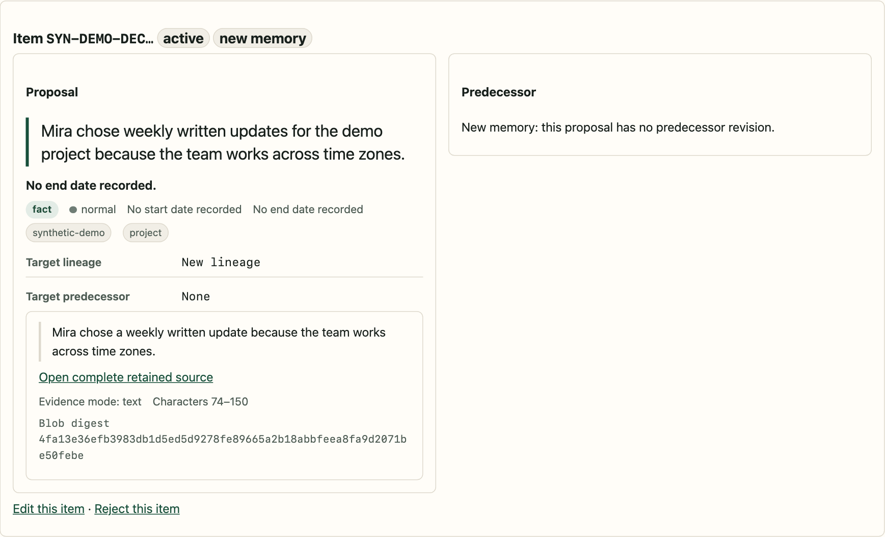
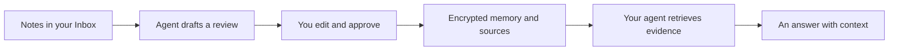

# Memory

[](https://github.com/li-shangru/Memory/actions/workflows/ci.yml)

**Give your AI a memory you can inspect and approve.**

Memory is an encrypted, local store for the notes, decisions, preferences, and
follow-ups you want your AI assistants to remember. Connect an MCP client such
as Codex or Claude Code, review what it proposes to keep, and ask questions
against the same retained evidence across sessions.

**macOS · Apple silicon · Python 3.14 · MCP · MIT**

[Get started](#get-started) · [How it works](#how-it-works) ·
[Documentation](docs/README.md) · [Contributing](docs/contributing.md)



*An actual review card from the local UI, showing synthetic demonstration content.*

## Why Memory?

Useful context gets scattered across conversations and files. Repeating it is
work. A summary can lose the reason behind a decision, and an assistant's
interpretation can quietly become something you never meant to say.

Memory gives that context a place with explicit ownership:

- **Carry context between sessions.** Compatible clients can consult the same
  local Store through MCP.
- **Choose what becomes memory.** The agent drafts a review; you edit, reject,
  or approve its items before they become owner-approved memory.
- **Keep the evidence.** Every approved memory points to retained sources.
  You and your agent can read the originals and inspect correction history.
- **Keep storage on your Mac.** SQLCipher encrypts the Store, with its key held
  in macOS Keychain. Memory has no hosted account or model API of its own.
- **Use your existing assistant.** Memory handles storage and retrieval; your
  connected agent supplies the reasoning and answers.

For example, you could retain the reasons behind a project decision, correct
a preference when it changes, or ask which follow-ups you have recorded.
Answer quality still depends on the client finding and reading the right evidence.

## How it works



1. Put **copies** of notes or documents into the Inbox, or upload them through
   the local UI.
2. Ask your connected agent to process the Inbox. A scan seals a batch; the
   agent proposes one review accounting for every source in that batch.
3. Open **Pending Reviews** in `memory ui`. Inspect the proposals and evidence,
   make changes, then approve the exact revision through macOS authentication.
4. Ask questions normally. The agent retrieves approved memory and original
   sources. Later corrections append history rather than overwriting it.

The MCP interface exposes fourteen bounded operations for sources, Inbox
batches, memory, and reviews. It exposes no raw SQL or database-file access.
See the [technical design](docs/technical-design.md) for the full contract.

## Get started

You need **macOS 26 or newer on Apple silicon**, **Python 3.14**,
[uv](https://docs.astral.sh/uv/getting-started/installation/), and an MCP client
for the agent workflow. Windows, Linux, and Intel Macs are not supported by
the companion dependencies.

Clone this repository, fetch the verified companion wheels, and install:

```sh
git clone https://github.com/li-shangru/Memory.git
cd Memory
python3 third_party/fetch-wheels.py
uv tool install --python 3.14 .
memory --version
```

If `memory` is not found, run `uv tool update-shell`, open a new terminal,
and try again. Install from this checkout; `pip install memory` is not the
installation method for this project. The fetch command downloads all three
versioned assets from [vendored-wheels-1](https://github.com/li-shangru/Memory/releases/tag/vendored-wheels-1)
and checks the SHA-256 manifests kept in Git. Downloads live in the ignored
`third_party/wheels/` cache; wheel binaries are absent from published branch/tag history.
[Installation details and troubleshooting →](docs/owner-guide.md)

Create your Store and open the local UI:

```sh
memory init
memory ui
```

The default Store is `~/Library/Application Support/Memory`. The UI opens in
your browser and its server runs in the foreground. Press Ctrl-C to stop it.
For a separate location, use the same `--home` with every command and in your
client configuration; see the [first-memory walkthrough](docs/getting-started.md).

Print the MCP configuration for your client:

```sh
memory mcp config --format toml  # TOML clients
memory mcp config --format json  # JSON clients
```

Add the generated entry to your client's MCP settings. Install the packaged
`using-memory` Skill if your client supports Skills, then restart the client.
The [client setup guide](docs/client-setup.md#connect-a-client-for-everyday-use)
explains where the entry belongs, executable paths, and Skill installation.

Start with a fictional note from the [walkthrough](docs/getting-started.md), then ask:

> Process the Memory Inbox and prepare a review for me. Show the evidence for
> each proposed memory.

After approving it, try:

> What did I record about the demo project? Cite the retained source and
> distinguish the recorded facts from your interpretation.

## Know before you import

- **Scanning takes custody.** A successful scan removes captured files from the
  Inbox after storing them. Put copies there; keep your originals elsewhere.
- **History is append-only.** There is no individual hard-delete or redaction
  feature. Corrections supersede memories but do not erase retained sources.
- **Local storage is one part of privacy.** A connected client can read retained
  sources, including material still awaiting memory approval, at every sensitivity
  level. It may send that content to its model provider. Connect only clients
  you trust; sensitivity labels are metadata, not access controls.
- **One owner, one Mac.** Keep the Store out of shared or synced folders. Backup
  and recovery require both the Store files and the corresponding Keychain item.
- **Retrieval has limits.** Search is lexical. Binary sources are retained and
  readable, but are not automatically OCRed, transcribed, or semantically indexed.
  The agent must broaden its reads when search is insufficient.

See [security and privacy](docs/security.md), the
[operational limits](docs/technical-design.md#12-limitations-and-operational-notes),
and [export format](docs/export-format.md). This project is not a password vault.

## Explore and contribute

| I want to… | Start here |
| --- | --- |
| Create and retrieve my first memory | [Walkthrough](docs/getting-started.md) |
| Browse, correct, export, or back up retained content | [Owner guide](docs/owner-guide.md) |
| Connect an agent | [Client setup](docs/client-setup.md) |
| Understand the storage and approval design | [Technical design](docs/technical-design.md) |
| Run tests or submit a fix | [Contributing](docs/contributing.md) |
| Inspect what this release has verified | [Verification](docs/verification/README.md) |

Bug reports should include the version, platform, and a small synthetic
reproduction. Keep personal notes, Store files, credentials, and client
transcripts out of issues. [Reporting guidance](docs/security.md#reporting-a-problem)

<details>
<summary>Version and dependency details</summary>

Version 1.13.0. Runtime: Python 3.14, MCP Python SDK 2, SQLCipher 4.17.0,
SQLite 3.53.3, and OpenSSL 4.0.1. Development uses Playwright 1.62.0+memory.1.
The repository includes source, synthetic tests, dependency build recipes,
licenses, and pinned wheel hashes. Companion binaries are versioned Release
assets; [fetch them before building or testing](third_party/README.md).
It starts with public source history; earlier
private development records are not part of this distribution.

</details>

## License

Created and maintained by [Shangru Li](https://github.com/li-shangru).

Memory's original code and documentation are available under the [MIT license](LICENSE).
Bundled third-party components retain their own licenses and notices; see
[third-party notices](docs/third-party-notices.md).
